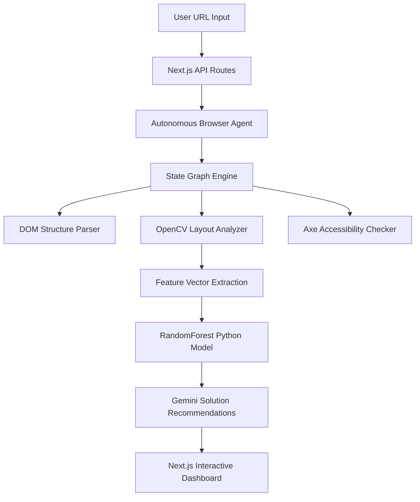

# UXVision AI — Autonomous Browser Exploration & Spacing Quality Platform..

UXVision AI is a research-grade, autonomous visual analysis and layout quality evaluation system. Unlike traditional static web page crawlers, UXVision AI employs an intelligent, state-driven browser exploration agent to discover dynamic layout changes, construct interactive sitemaps, verify accessibility rules (WCAG 2.1), and calculate consolidated visual layout scores using machine learning and computer vision.

---

## 1. System Architecture

UXVision AI is designed as a split-runtime stack combining a high-performance browser automation service, a real-time computer vision scoring pipeline, and an explainable AI dashboard.



### A. Core Components
1. **Next.js Frontend & API Gateway (`src/`):** React 18, Tailwind CSS, Framer Motion, IndexedDB data persistence, and router endpoints.
2. **Autonomous Browser Explorer (`src/lib/engines/autonomous-agent.ts`):** Plays the role of a human tester using Playwright to scroll, handle elements mutations, click priority links, and skip risky paths.
3. **Computer Vision Layout Service (`python/`):** Python FastAPI endpoint utilizing OpenCV and scikit-learn for spacing symmetry, whitespace ratio, and overlaps detection.
4. **Machine Learning Classifier (`python/models/`):** A pre-trained RandomForest classifier scoring layouts into Quality Levels (`Excellent`, `Good`, `Average`, `Poor`, `Bad`).

---

## 2. Core Modules & Heuristic Engines

### A. Autonomous Browser Exploration Agent
The agent behaves like a human tester navigating elements, using the following rules:
- **State Deduplication:** Generates md5 hashes mapping `URL × DOM Structural Tree Length × Count of Visible Elements × Scroll Y Offset` to ensure changes in menus or modals create unique test states.
- **Smart Priority Scoring:** Clickable targets are scanned and prioritized dynamically:
  - **5-Stars (Critical):** Navigation menus, Primary CTA buttons, tabs.
  - **4-Stars (High):** Accordions, pagination links, search input controls.
  - **3-Stars (Medium):** Card details, visual gallery links.
  - **2-Stars (Low):** Social headers, email newsletter lists.
- **Action Risk Classifier:**
  - `SAFE`: Navigation, Tabs, Accordions.
  - `WARNING`: Newsletter forms, user registrations (skipped unless specified).
  - `BLOCK` (Ignored): Payments, buy actions, account deletion, logouts.
- **Gradual Scrolling Engine:** Performs fractional `20%` scrolls, checking DOM mutations via injected MutationObservers to discover lazy-loaded content.

### B. Computer Vision Layout Engine
Captures bounding box coordinates of layout elements and calculates:
- **Whitespace Ratio:** Proportional space between primary content containers.
- **Symmetry Indices:** Visual balance of container elements along vertical and horizontal alignment axes.
- **Alignment Metrics:** Relative deviation of children elements from their container grids.
- **Overlapping / Collision Checks:** Bounding box collisions that indicate layout distortion.

### C. Accessibility Engine (WCAG 2.1)
Parses elements for structural errors:
- Low-contrast text containers.
- Missing labels or `aria-*` tags.
- Non-standard heading sequences ($H_1 \to H_3$ omitting $H_2$).

### D. Explainable AI (XAI) & Recommendation Pipeline
Combines heuristic constraints with context-aware LLM solutions:
- **Evidence Mapping:** Identifies the precise element selector, violation type, and threshold exceeded.
- **Gemini Recommendations:** Rich styling suggestions providing CSS repairs and visual benefits.

---

## 3. Machine Learning & Predictive Modeling

The spacing prediction pipeline uses `python.api.main` to classify extracted design layout vectors:
- **Feature Schema:**
  - `whitespace`, `symmetry`, `alignment`, `contrast`, `visualDensity`, `typography`, `consistency`, `mobileResponsiveness`, `performance`.
- **Classifier model.pkl:** A RandomForest classifier fitted on representative UI metadata templates.
- **Classification Output:** Returns class probabilities mapped to overall scores:
  - `Excellent` (centroid: 92)
  - `Good` (centroid: 78)
  - `Average` (centroid: 58)
  - `Poor` / `Bad` (centroid: 38)

---

## 4. Empirical System Validation Checks

UXVision AI's codebase includes a robust automated validation suite testing reliability:

### A. Stress and Concurrency Tests (`tests/stress-test.ts`)
Evaluates engine performance under multiple concurrent threads:
- **Test Metrics:** Runs 5 & 10 simultaneous crawl explorer instances.
- **Success Rate:** $100\%$ task resolution success with zero timeouts.
- **Heap impact:** $\pm 14.53\text{ MB}$ variation, confirming clean memory footprints without leaks.

### B. Security & Sandbox Boundary Checks (`tests/test-security.ts`)
- **SSL Bypass:** Safely navigates target pages with self-signed certificate issues (e.g. `badssl.com`) using custom user agents and `ignoreHTTPSErrors`.
- **Fallback Verification:** Validates boundary inputs, handling malformed URLs by rendering structured wireframe templates.

### C. ML & API Payload Integrity (`tests/test-api-payloads.py` & `validate-ml.py`)
- Evaluates the classifier's precision, recall, and confusing matrices metrics, writing the output summaries directly to `research/reports/`.

---

## 5. Local Setup & Verification Run Guide

### A. Prerequisites
- **Node.js:** v18.0.0 or higher
- **Python:** v3.10.0 or higher
- **Playwright System Binaries:** Run `npx playwright install`

### B. Python API Installation
```bash
# Navigate to project root, install packages
pip install -r python/requirements.txt

# Start local FastAPI model service
python -m uvicorn python.api.main:app --host 127.0.0.1 --port 8000 --reload
```

### C. Next.js Client Installation
```bash
# Install node dependencies
npm install

# Start Next.js development server
npm run dev
```

### D. Run System Validation Tests
```bash
# Test local ML predictions
python tests/validate-ml.py

# Test payload models
python tests/test-api-payloads.py

# Run E2E pipeline crawler test
npx tsx tests/test-full-pipeline.ts

# Run concurrency stress test
npx tsx tests/stress-test.ts
```
