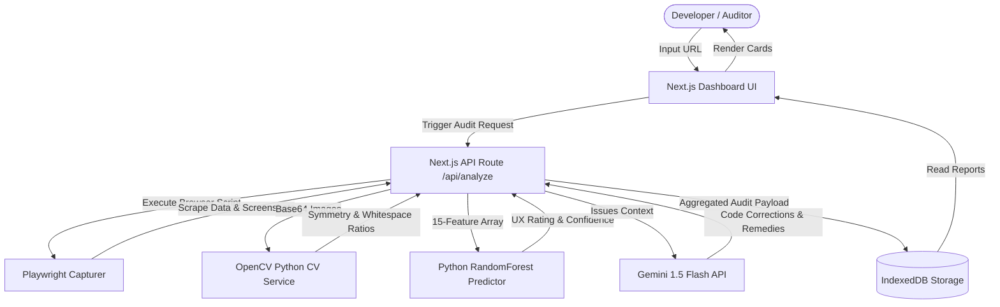
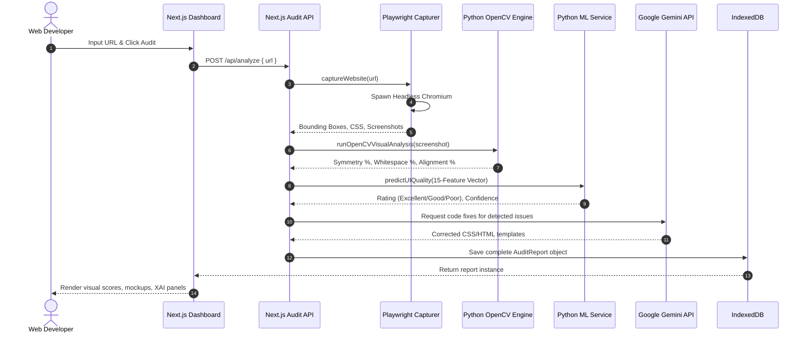
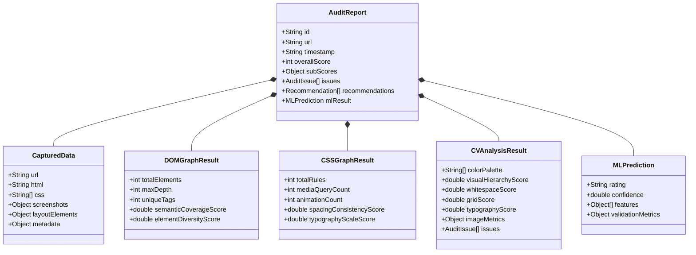
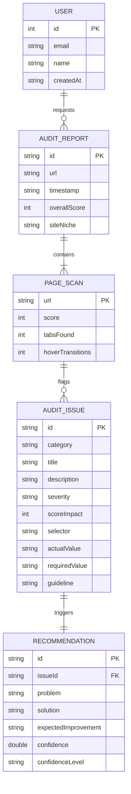

# System Architecture & Design Diagrams

This document contains visual diagrams for the UXVision AI research platform built using Mermaid syntax.

## 1. Use Case Diagram

```mermaid
usecaseDiagram
    actor User as "Client User (Web Developer)"
    actor Gemini as "Gemini API (GenAI Orchestrator)"
    actor Playwright as "Playwright Engine"
    
    rect "UXVision AI Platform" {
        usecase UC1 as "Trigger Website Crawl"
        usecase UC2 as "View Visual Audit Dashboard"
        usecase UC3 as "Interact with XAI Chat Assistant"
        usecase UC4 as "Apply CSS Layout Redesigns"
        usecase UC5 as "Evaluate Machine Learning Models"
        usecase UC6 as "Run OpenCV Computer Vision Filters"
    }

    User --> UC1
    User --> UC2
    User --> UC3
    User --> UC4
    User --> UC5

    UC1 ..> Playwright : "Spawns browser"
    UC2 ..> UC6 : "Calculates Symmetry & Whitespace"
    UC3 ..> Gemini : "Explains scoring logic"
```

## 2. Level 1 Data Flow Diagram (DFD)



## 3. Sequence Diagram



## 4. Logical Class Diagram



## 5. Entity-Relationship (ER) Diagram


